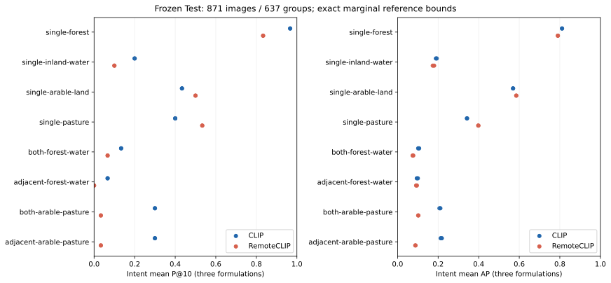

# Robust Compositional Retrieval in Earth Observation

## Abstract

We investigate whether frozen image–text models retrieve satellite images that
satisfy several conditions at once. We compare CLIP and RemoteCLIP ViT-B/32 on
871 spatially held-out Sentinel-2 images, eight land-cover intents and three formulations
per intent. Relevance means agreement with fixed land-cover map rules.
CLIP achieves mean precision at ten of 35.00%, versus RemoteCLIP's 26.25%.
RemoteCLIP has slightly higher average precision for single concepts, while
CLIP leads on conjunctions and adjacency. Equivalent wording changes the
retrieved sets substantially. These are descriptive findings for this benchmark;
the small relation controls cannot establish general spatial reasoning.

## Research Questions

1. How does retrieval quality change from single concepts to combinations and relations?
2. How much does equivalent wording change the results?
3. Does the model comparison depend on the type of query?

For example, *forest*, *forest and water*, and *forest adjacent to water*
require progressively more conditions. Finding only forest does not satisfy
the latter two queries.

## Data and Retrieval Task

We use Sentinel-2 satellite-image patches and CLC2018 land-cover maps from
BigEarthNet-v2, with BigEarthNet.txt providing the original image–text context.
A deterministic, country-balanced selection yields 2,013 verified image/map
pairs, including the initial pilot. Nearby and overlapping patches stay
in the same spatial group: 1,142 images are used for development and 871
for testing.
Selection did not use model rankings. Original captions are not used in retrieval
or relevance scoring.

The eight intents concern forest, inland water, arable land and pasture,
two combinations of these classes, and their adjacency versions. An *intent*
is one relevance condition; its three *paraphrases* express that same condition
with different English wording. Every main query searches all 871 test images.

The reference measures **map agreement**, not independently verified visual
truth. A class must cover at least 5% of the patch; adjacency also requires
at least 60 m of shared mapped boundary. Unknown evidence stays unknown.
The map's 10 m storage grid is finer than its underlying cartographic detail.
[Reference rules](docs/REFERENCE_SPECIFICATION.md) and
[benchmark design](docs/BENCHMARK_DESIGN.md) explain these choices.

## Methodology

Both models use the same ViT-B/32 architecture and remain frozen: no training
or fine-tuning occurs. CLIP is a general-purpose image–text baseline;
RemoteCLIP provides a remote-sensing counterpart. Each receives RGB images
and query text only, using its specified preprocessing.

Image and text embeddings are normalized, and all candidates are ranked by
cosine similarity. Maps, captions and metadata do not affect the scores.
The [model specifications](config/frozen-models-v1.json) identify the checkpoints
and preprocessing.

Precision at ten (**P@10**) is the relevant fraction of the first ten hits.
**Average precision (AP)** rewards relevant images appearing early across
the full ranking. We average the three formulations within each intent,
then weight the eight intents equally.

For the few unknown reference labels, we enumerate possible assignments
and report the resulting metric ranges. Both models and all formulations of an
intent share the same assignment. Aggregate ranges are conservative: dependencies
between intents may make their endpoints unattainable together. They describe
reference ambiguity, not statistical confidence.
The [analysis protocol](docs/ANALYSIS_PROTOCOL.md) gives the equations.
Only two dependent intent families exist, so the results do not support
broad statistical claims about model superiority.

## Results

AP ranges reflect unknown reference labels and are conservatively aggregated
across intents. These labels do not affect the reported P@10 values.

| Query type | CLIP P@10 | RemoteCLIP P@10 | CLIP AP | RemoteCLIP AP |
|---|---:|---:|---:|---:|
| All eight intents | 35.00% | 26.25% | 0.3158–0.3190 | 0.2876–0.2899 |
| Single concept | 50.00% | 49.17% | 0.4778–0.4791 | 0.4866–0.4887 |
| Conjunction | 21.67% | 5.00% | 0.1541–0.1586 | 0.0878–0.0900 |
| Adjacency | 18.33% | 1.67% | 0.1537–0.1591 | 0.0893–0.0920 |



CLIP's aggregate AP advantage persists across possible assignments of the
unknown labels: the paired RemoteCLIP-minus-CLIP range is
−0.03047 to −0.02689. The comparison varies by concept. RemoteCLIP gains on
arable land and pasture, while CLIP leads on forest and water. Lower composite
scores also reflect rarer positives; the comparison alone does not isolate
compositional reasoning.

Equivalent wording changes the top-ten sets substantially. Their mean Jaccard
overlap is 0.1931 for CLIP and 0.2308 for RemoteCLIP, where one means identical
sets. Within-intent P@10 ranges reach 0.6. Higher overlap does not imply
better quality, and three formulations do not establish robustness to
arbitrary language. [Notebook 03](notebooks/03_retrieval_evaluation.ipynb)
shows the detailed comparison.

### How much does prevalence explain?

A post-hoc comparison with random rankings helps interpret these differences.
For a uniform random ranking, expected P@10 equals the fraction of relevant
images. Forest already occurs in 63.03% of the main pool; its measured P@10
is 96.67% for CLIP and 83.33% for RemoteCLIP. Other intents have different
prevalences, so raw quality across query types is not directly comparable.

The separate relation controls include only images with both classes present.
Forest/water has 35 positive and two negative cases; arable/pasture has
59 positive and seven negative cases. Their high baseline prevalence matters:

| Exploratory control | Random expected P@10 | CLIP P@10 | RemoteCLIP P@10 |
|---|---:|---:|---:|
| Forest/water adjacency | 94.59% | 100.00% | 100.00% |
| Arable/pasture adjacency | 89.39% | 96.67% | 80.00% |

These expectations are not significance tests. Few negative examples limit
conclusions about spatial reasoning, so the controls are exploratory and separate
from the main comparison. The [random-reference calculation](docs/COMPLETION_REVIEW.md)
gives the analytical expectations.

## Error Analysis

[Notebook 04](notebooks/04_error_analysis.ipynb) inspects the predeclared
first formulation at ranks 1, 5 and 10 for every intent and model:
48 slots containing 35 unique images. CLIP satisfies the map condition in
nine of its 24 slots, RemoteCLIP in five. These fixed examples are a diagnostic
sample, not an unbiased estimate of error frequency.

Many composite failures already miss one required class. The sample contains
no both-present-but-false relation, so it cannot isolate relation mistakes.
RGB often shows finer landscape detail than the map. Arable versus pasture
use cannot be reliably verified from one RGB image, and possible snow or
shadow effects remain hypotheses.

## Main Findings

- CLIP has higher descriptive aggregate quality here; the gap depends on query type.
- Equivalent wording changes both quality and the retrieved sets.
- Reference ambiguity does not reverse the aggregate AP comparison.
- Prevalence, generalized maps and sparse relation negatives limit explanations
  of compositional or spatial reasoning.

## Reproduction

The final run used Apple M2 Pro, CPU float32 and the locked Python environment.
Each model encoded 871 images and 24 texts. Reproduction requires the source
rasters and model checkpoints, which are not included in the repository.

```bash
uv sync --locked
uv run python scripts/evaluate_final.py
```

[Reproduction instructions](docs/REPRODUCTION.md) cover data and model setup,
notebook execution and verification. The analyses are available in four notebooks:

1. [Data understanding](notebooks/01_data_understanding.ipynb): can inputs be matched?
2. [Benchmark construction](notebooks/02_benchmark_construction.ipynb): what counts as relevant?
3. [Retrieval evaluation](notebooks/03_retrieval_evaluation.ipynb): how do the models compare?
4. [Error analysis](notebooks/04_error_analysis.ipynb): what do selected failures reveal?

## Limitations

The country-balanced subset is not representative of operational archive
prevalence. Eight intents in two families, generalized map labels and possible
pretraining overlap limit transfer to other questions and datasets. Spatial
grouping reduces nearby leakage but does not prove statistical independence.
Reference envelopes describe label ambiguity, not sampling uncertainty.
Stronger claims about visible relations would require a study with independently
validated references and more negative relation examples.
